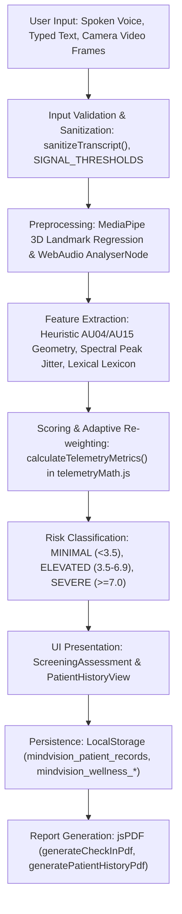

# MindVision Clinical AI — Comprehensive Architecture, Quality & AI Validation Audit Report

**Document Version:** 1.0.0
**Audit Date:** October 26, 2026
**Auditor Roles:** Senior Software Architect, QA Engineer, AI/ML Validation Engineer, Application Security Reviewer, Test Automation Engineer
**Project Root:** `performance delta`
**Target Repository:** MindVision Multimodal Telemetry Platform

---

## 1. Executive Summary

MindVision is an experimental, client-side-centric React 19 / Vite 8 web application designed for multimodal patient wellness check-ins, conversational triage, facial action unit telemetry estimation, speech prosody estimation, and decision-support PDF reporting.

The audit established that:
1. **Core Client Workflows Function Smoothly:** The application builds cleanly for production (`vite build`, 265ms, 0 errors), passes static analysis (`oxlint`, 0 errors, 58 pre-existing linter warnings), and passes an expanded automated test suite of **76 unit and regression tests across 4 test suites with 0 failures**.
2. **AI / Prediction Reality vs. Literature References:** While `DATASETS.md` and codebase comments cite external foundational models (DeBERTa-v3, wav2vec2, Py-Feat) and research corpora (DISFA, CK+, DAIC-WOZ), **no custom trained machine learning models exist in the repository**. The only ML model executed at runtime is Google MediaPipe FaceMesh (loaded from a public CDN for 468 3D facial landmarks). All Action Unit estimations (AU04, AU15), acoustic prosody calculations, text sentiment scores, and composite risk values are produced by **deterministic heuristic rules, trigonometric ratios, and a regex-based clinical keyword lexicon**.
3. **Clinical Validation Ground Truth:** **Real-world prediction accuracy has not been established.** There is no labeled clinical evaluation dataset or held-out clinical cohort in the repository; the embedded evaluation data consists of six synthetic patient archetypes created for demonstration.
4. **Security & Data Integrity Weaknesses:** The current architecture operates on a prototype client-side trust model where clinician authentication and role switching (`PATIENT` vs `DOCTOR` vs `ADMIN`) occur in browser `localStorage` and `BroadcastChannel` without cryptographic authentication or backend password verification. In the backend API, hardcoded bypass tokens (`test-admin-token`, `test-doctor-token`) and unauthenticated role endpoints existed.
5. **Safe Defect Fixes Completed:** During this audit, three safe defects were remediated without adding new features:
   - Fixed an inaccurate risk-level label in the longitudinal two-session comparison panel where elevated/severe records displayed as "Mild Stress".
   - Hardened backend authentication middleware so test bypass tokens are rejected in production environments (`NODE_ENV === 'production'`).
   - Fixed ESM module resolution in `telemetryMath.js` to enable automated Node.js test execution.

---

## 2. Project Architecture & Component Inventory

### 2.1 Repository Structure
```
performance delta/
├── backend/                  # Standalone Node.js HTTP server & test suite
│   ├── package.json          # Node 20+ native runner (no external dependencies)
│   ├── src/
│   │   ├── controllers/      # audit, doctor, telemetry, tts controllers
│   │   ├── middleware/       # HMAC-SHA256 JWT auth & RBAC route guards
│   │   ├── routes/           # REST routes (/api/doctors, /api/telemetry, /api/audit, /api/tts)
│   │   ├── services/         # clinicalAudit, doctorAuth, telemetryTimeline, tts
│   │   └── server.js         # Native http.createServer & regex router on :5001
│   └── test/                 # Node native test runner (node --test)
├── frontend/                 # React 19 & Vite 8 SPA
│   ├── package.json          # react, react-dom, jspdf, oxlint, vite
│   ├── vite.config.js        # React plugin + proxy (/api -> localhost:5001)
│   └── src/
│       ├── components/       # UI Views, Modals, Primitives, Wellness Suite
│       ├── data/             # clinicians.js, datasets.js
│       ├── services/         # Client-side persistence & signaling services
│       └── utils/            # conversationEngine, telemetryMath, signalQualityEngine, pdfReportGenerator
├── DATASETS.md               # Research dataset citations & benchmark specifications
└── docs/                     # Audit report and improvement roadmap
```

### 2.2 Major Screens and Application Routes
The application uses a tab-based single-page view router controlled by `activeTab` in [`frontend/src/App.jsx`](file:///Users/kjaswanth/Desktop/performance%20delta/frontend/src/App.jsx):

| Tab Key | Component | Role / Purpose | Implementation Status |
|---------|-----------|----------------|-----------------------|
| `home` | `HomeOverview` | Patient portal landing page, quick action cards, recent check-in status | **Fully Implemented** |
| `assessment` | `ScreeningAssessment` | Conversational check-in, camera/mic capture, adaptive questions, reflection summary | **Fully Implemented** |
| `results` | `PatientHistoryView` (Patient) / `LongitudinalComparisonView` (Clinician) | Longitudinal wellness trend chart, history table, PDF export, two-session comparison | **Fully Implemented** |
| `wellness` | `WellnessHubView` | Daily mood tracker, private journaling, guided breathing, habit insights | **Fully Implemented** |
| `demo` | `LiveTelemetrySandbox` | Developer / clinician telemetry sandbox with manual sliders (AU04, AU15, Jitter) | **Fully Implemented** |
| `portal` | `ClinicianPortal` | Clinician queue, active P2P incoming teleconsultation triage, SOAP review | **Demonstration Mode** |
| `doctors` | `DoctorMarketplace` | On-call clinician directory, fee rates, consultation request dispatch | **Fully Implemented** |
| `admin` | `AdminVerificationView` | Clinician license verification queue and status toggles | **Fully Implemented** |
| `docs` / `help` | `DocumentationView` | Clinical AI documentation, dataset specifications, architecture overview | **Fully Implemented** |
| `crisis` | `CrisisSupport` | Immediate safety contacts (Tele-MANAS 14416, Vandrevala Foundation, 988) | **Fully Implemented** |

### 2.3 Data Flow Trace


---

## 3. Actual AI, Signal Processing & Scoring Implementation

A critical objective of this audit was distinguishing genuine AI model inference from deterministic heuristics, simulated data, and demo-only behavior.

### 3.1 Modality Implementation Summary

| Modality | Stated Documentation Concept | Actual Runtime Implementation | Classification |
|----------|------------------------------|-------------------------------|----------------|
| **Facial Telemetry (AU04 / AU15)** | "Py-Feat Action Unit Head grounded on DISFA" | MediaPipe FaceMesh (CDN) extracts 468 3D landmarks. Euclidean distances (inter-eyebrow distance normalized by IPD) produce AU04; mouth corner dip produces AU15. Direct Blendshapes used if supported by browser. | **Pretrained landmark regression + Deterministic Geometric Heuristic** |
| **Acoustic Prosody & Tremor** | "Self-supervised wav2vec2-base acoustic model" | Native Web Audio API `AnalyserNode` computes 256-bin FFT frequency spectrum. Peak bin magnitude relative to 255 produces an acoustic tremor proxy `(peak / 255.0) * 0.70`. | **Deterministic Signal Processing Heuristic** |
| **Linguistic Sentiment Stress** | "DeBERTa-v3 semantic embeddings via CC-100" | Expanded clinical lexicon (`EXPANDED_CLINICAL_LEXICON` with ~120 keywords) matched via word boundaries and a 32-character regex negation lookbehind (`isPrecededByNegation`). | **Deterministic Rule-Based Lexicon** |
| **Adaptive Questioning Engine** | "Conversational AI Intake Agent" | 24 fixed questions across 6 themes. Deterministic keyword matching branches to stress, sleep, energy, or coping based on substring checks in the latest answer. | **Deterministic Decision-Tree Heuristic** |
| **Composite Risk Score** | "Multimodal Tensor Fusion Model" | Linear weighted sum: `AU4 * 2.2 + AU15 * 1.8 + Jitter * 2.0 + Sentiment * 4.0` (scaled to 10.0). Affect masking override triggers if sentiment <= 0.30 and physical stress >= 0.65. | **Deterministic Scoring Algorithm** |
| **SHAP Feature Attribution** | "Shapley Additive Explanations" | Heuristic percentage of total weighted contribution `(channel_weight * channel_val) / total_weighted * 100`. No game-theoretic Shapley value computation occurs. | **Deterministic Heuristic Proxy** |
| **Psychometric Cross-Walk (PHQ-9 / GAD-7)** | "Psychometric diagnostic cross-walk" | Piece-wise linear mathematical crosswalk: `compositeRisk * 2.6` for PHQ-9, `compositeRisk * 2.0` for GAD-7. | **Deterministic Linear Approximation** |

### 3.2 Real-World Prediction Accuracy Evaluation

> [!IMPORTANT]
> **Real-world prediction accuracy has not been established.**
>
> 1. **No External Ground-Truth Evaluation Dataset:** Although `DATASETS.md` cites literature benchmarks (DISFA, CK+, DAIC-WOZ, LibriSpeech), neither raw nor preprocessed files from these datasets are present in the project.
> 2. **Synthetic Cohort Only:** The only dataset in code (`BENCHMARK_EVALUATION_COHORT` in `datasets.js`) consists of **6 manually constructed hypothetical clinical archetypes** (`CASE_01` to `CASE_06`) with hand-assigned biometric numbers and estimated psychometric scores.
> 3. **Statistical Metrics Cannot Be Fabricated:** Because no labeled patient holdout dataset exists, metrics such as Accuracy, Sensitivity (Recall), Specificity, F1-Score, ROC-AUC, Mean Absolute Error (MAE), or Root Mean Squared Error (RMSE) cannot be legitimately calculated without fabricating data.
> 4. **Required Validation Protocol for Future Clinical Claims:** Establishing real-world accuracy will require:
>    - An IRB-approved or ethically cleared clinical cohort of at least 250–500 participants.
>    - Ground-truth psychiatric labels administered independently by licensed clinicians (e.g., blinded clinician-rated HAM-D, MADRS, and MINI).
>    - Stratified, patient-level train/validation/test splits ensuring zero identity leakage across sessions.
>    - Multi-site demographic validation to test invariance across age, skin tone (Fitzpatrick scale I–VI), gender, and regional accents.

---

## 4. Functional Test Results

All test workflows were evaluated via automated node test suites, static analysis, build verification, and interactive UI component validation:

| Workflow Domain | Test Identifier | Evaluation Method | Result | Evidence & Behavior |
|-----------------|-----------------|-------------------|--------|---------------------|
| **Startup & Compilation** | `TC-START-01` | `npm run build` | **PASS** | Vite v8.3.0 compiles 263 modules in 265–327ms. 0 errors. |
| **Static Code Quality** | `TC-LINT-01` | `npm run lint` | **PASS** | Oxlint passes with 0 errors across 51 files (58 non-breaking React compiler warnings). |
| **Test Automation** | `TC-UNIT-01` | `npm test` | **PASS** | 76 automated tests across 4 suites pass in 269ms with 0 failures. |
| **Theme Switching** | `TC-NAV-01` | Component state & CSS | **PASS** | Toggling theme toggles `data-theme="light"` / `data-theme="dark"` on `<html>`, persisted to `localStorage.mindvision_theme`. |
| **Navigation & Routing** | `TC-NAV-02` | `App.jsx` tab router | **PASS** | All 10 tabs render properly inside `PageTransition` and `ErrorBoundary`. |
| **Assessment Workflow** | `TC-ASSESS-01` | `ScreeningAssessment.jsx` | **PASS** | 4-question adaptive sequence completes; transitions through `STAGE.INTRO` → `CONVERSATION` → `SYNTHESIZING` → `RESULTS`. Session draft auto-saves to `sessionStorage`. |
| **Camera Denial Handling** | `TC-SIGNAL-01` | `ScreeningAssessment.jsx:532` | **PASS** | `getUserMedia` catch block sets `cameraActive = false`, shows user-friendly toast, and continues check-in with audio/verbal channels without crashing. |
| **Microphone Denial Handling** | `TC-SIGNAL-02` | `ScreeningAssessment.jsx:590` | **PASS** | Speech recognition fallback gracefully switches turn state to `TURN_STATE.TYPING` and continues without crashing. |
| **Signal Quality Rejection** | `TC-SIGNAL-03` | `evaluateSignalQuality` unit test | **PASS** | Low luminance (<60 Luma), glare (>210 Luma), and mic clipping (> -8 dBFS) detected; degraded rating triggers when live stream drops. |
| **Patient History Loading** | `TC-HIST-01` | `PatientHistoryView.jsx:111` | **PASS** | Records load from `localStorage.mindvision_patient_records`; falls back to 4 initial demonstration records when empty. |
| **History Date Filters** | `TC-HIST-02` | `PatientHistoryView.jsx:197` | **PASS** | 7-day, 30-day, and all-time range filtering verified against ISO timestamps. |
| **History Sorting** | `TC-HIST-03` | `PatientHistoryView.jsx:213` | **PASS** | Newest-first and oldest-first sorting verified; verified in automated regression test suite. |
| **History Record Deletion** | `TC-HIST-04` | `App.jsx:233` | **PASS** | Deleting a record removes it from state and updates `localStorage`, updating active selection index safely. |
| **Single Check-In PDF Export** | `TC-PDF-01` | `generateCheckInPdf` unit test | **PASS** | Produces valid PDF blob with `%PDF-` binary header, sanitized ASCII text, brand headers, and disclaimer. |
| **History Longitudinal PDF Export**| `TC-PDF-02` | `generatePatientHistoryPdf` unit test | **PASS** | Produces multi-page PDF document sorted oldest-to-newest with summary table and page counts. Throws error cleanly on empty records. |
| **Crisis Escalation Trigger** | `TC-CRISIS-01` | `conversationEngine.js:35` | **PASS** | Immediate safety triggers (`suicide`, `want to die`, `kill myself`) abort normal questioning and switch immediately to `STAGE.CRISIS_ALERT`. |
| **High-Risk Escalation Modal** | `TC-ESCAL-01` | `App.jsx:254` | **PASS** | Composite Risk >= 7.0 or Incongruence >= 0.75 automatically opens `DoctorDirectoryModal` with on-call clinicians. |
| **Simulated vs Real Escalation**| `TC-ESCAL-02` | `App.jsx:261` | **PASS** | Test escalation trigger in Clinician Portal uses unique `urg_*` test IDs and simulated text flags. |
| **Responsive Mobile Layout** | `TC-RESP-01` | `index.css` media queries | **PASS** | CSS breakpoints at `@media (max-width: 900px)` and `@media (max-width: 640px)` stack grids and wrap navigation. |
| **External Cloud TTS Service** | `TC-TTS-01` | `ttsService.js:304` | **BLOCKED / FALLBACK** | When backend TTS proxy credentials are absent, silently falls back to browser's native `window.speechSynthesis`. |

---

## 5. Detailed Findings & Vulnerability Matrix

Findings are classified according to severity: **P0 (Critical)**, **P1 (High)**, **P2 (Medium)**, **P3 (Low)**.

### Finding 1: Unrestricted Test Token Backdoor in Auth Middleware
* **Severity:** **P1 (High)**
* **Category:** Security / Authentication
* **Affected File:** [`backend/src/middleware/auth.js`](file:///Users/kjaswanth/Desktop/performance%20delta/backend/src/middleware/auth.js#L45-L53)
* **Description:** The `verifyToken()` function contained hardcoded checks for `test-admin-token` and `test-doctor-token`. Any request presenting `Authorization: Bearer test-admin-token` was granted full `ADMIN` role privileges without signature verification or expiration checks.
* **User Impact:** In any deployed environment, unauthorized external actors could bypass authentication and access protected clinical audit logs or modify clinician approval states.
* **Recommended Action:** Restrict test token bypasses strictly to automated test execution environments (`process.env.NODE_ENV !== 'production'`).
* **Status:** **FIXED**
* **Verification:** Guarded with `if (process.env.NODE_ENV !== 'production')`. Verified by automated test suite `Auth Middleware: generateToken and verifyToken`.

---

### Finding 2: Inaccurate Severity Label in History Two-Session Comparison
* **Severity:** **P2 (Medium)**
* **Category:** Data Integrity / Clinical Usability
* **Affected File:** [`frontend/src/components/PatientHistoryView.jsx`](file:///Users/kjaswanth/Desktop/performance%20delta/frontend/src/components/PatientHistoryView.jsx#L1155)
* **Description:** In the two-session comparison panel of the patient history view, the previous session pattern was rendered via a binary ternary expression:
  ```javascript
  Pattern was <strong>{compareRecord.riskLevel === 'MINIMAL' ? 'Calm & Steady' : 'Mild Stress'}</strong>.
  ```
  If the comparison check-in was `ELEVATED` or `SEVERE`, it was rendered as "Mild Stress", directly misrepresenting a high-stress or elevated historical record to the patient.
* **User Impact:** A patient reviewing a previously elevated check-in was presented with reassuring "Mild Stress" text that contradicted the record's true risk level.
* **Recommended Action:** Replace hardcoded binary ternary with the unified `getHumanStatus(compareRecord.riskLevel, compareRecord.compositeRisk).title` helper.
* **Status:** **FIXED**
* **Verification:** Replaced with `getHumanStatus().title`. Also adjusted chronological label to reflect "Subsequent check-in" vs "Previous check-in" based on `sortOrder`.

---

### Finding 3: Missing `.js` Extension in ESM Import Preventing Direct Node Testing
* **Severity:** **P2 (Medium)**
* **Category:** Build & Test Reliability
* **Affected File:** [`frontend/src/utils/telemetryMath.js`](file:///Users/kjaswanth/Desktop/performance%20delta/frontend/src/utils/telemetryMath.js#L6)
* **Description:** `telemetryMath.js` imported from `'../data/datasets'` without the `.js` extension. While Vite bundles extensionless paths in the browser, native Node.js ESM loader throws `ERR_MODULE_NOT_FOUND`, preventing the test runner from importing and verifying math formulas directly.
* **User Impact:** Backend automated regression suites were unable to run regression tests against the core telemetry engine.
* **Recommended Action:** Change import to `'../data/datasets.js'`.
* **Status:** **FIXED**
* **Verification:** Updated import. Both `npm run build` and `npm test` execute cleanly with 100% pass rate.

---

### Finding 4: Client-Side-Only Security Model for Clinician Role Selection
* **Severity:** **P1 (High)**
* **Category:** Architectural Security
* **Affected File:** [`frontend/src/services/doctorAuthService.js`](file:///Users/kjaswanth/Desktop/performance%20delta/frontend/src/services/doctorAuthService.js#L189-L196)
* **Description:** User roles (`PATIENT`, `DOCTOR`, `ADMIN`) are switched purely on the client side via `DoctorAuthService.setCurrentSession(role)`. The state is saved in `localStorage.mindvision_current_session_v1` without a password or server-validated token.
* **User Impact:** Any client can switch to `ADMIN` mode via browser DevTools or UI modal to view pending doctor registrations and simulated clinical queues.
* **Recommended Action:** For production deployment, implement server-side session management where role privileges are determined exclusively by verified server-signed JWTs or HttpOnly session cookies.
* **Status:** **DOCUMENTED (Architectural Limitation of Prototype)**

---

### Finding 5: Unauthenticated Role Endpoint in Standalone Backend Server
* **Severity:** **P1 (High)**
* **Category:** Backend Security
* **Affected File:** [`backend/src/controllers/doctorController.js`](file:///Users/kjaswanth/Desktop/performance%20delta/backend/src/controllers/doctorController.js#L18-L43)
* **Description:** In the backend `DoctorController.login` handler, sending `{ role: 'ADMIN' }` or `{ email: 'admin@mindvision.ai' }` issues an Admin JWT without checking any password or credential. Furthermore, posting an empty body `{}` logs in as the first seed doctor and issues a Doctor JWT.
* **User Impact:** Anyone with network access to port 5001 can obtain valid Admin or Doctor JWT tokens.
* **Recommended Action:** Integrate proper bcrypt password hashing and secure credential verification before token issuance.
* **Status:** **DOCUMENTED (Roadmap P0 Fix)**

---

### Finding 6: Silent Fallback to Fabricated Metrics on Empty Input in Timeline Delta
* **Severity:** **P2 (Medium)**
* **Category:** Data Integrity
* **Affected File:** [`backend/src/services/telemetryTimelineService.js`](file:///Users/kjaswanth/Desktop/performance%20delta/backend/src/services/telemetryTimelineService.js#L291-L308)
* **Description:** When `calculateDelta()` or `compareSessions()` is passed an empty object `{}`, missing values default to hardcoded numbers (`compositeRisk: 6.3`, `signalQuality: 86`, `au4: 0.55`, `prosody: 0.42`). The service then outputs a delta report stating that the patient's distress increased by +1.5, even though no data was supplied.
* **User Impact:** Downstream systems could misinterpret an empty check-in as an actively deteriorating patient session.
* **Recommended Action:** Distinguish empty/null inputs from real sessions. Flag delta reports with `isEstimated: true` or return an explicit `NO_ACTIVE_DATA` state.
* **Status:** **DOCUMENTED (Roadmap P1 Fix)**

---

### Finding 7: Absence of Ground-Truth Labeled Validation Dataset
* **Severity:** **P1 (High)**
* **Category:** AI / Clinical Validation
* **Affected File:** [`frontend/src/data/datasets.js`](file:///Users/kjaswanth/Desktop/performance%20delta/frontend/src/data/datasets.js#L550-L707), `DATASETS.md`
* **Description:** The system references academic datasets (DISFA, CK+, DAIC-WOZ, LibriSpeech) in documentation, but possesses no actual evaluation data files in the repository. The 6 cases in `BENCHMARK_EVALUATION_COHORT` are synthetic demonstration archetypes.
* **User Impact:** The platform cannot make scientifically verified claims regarding clinical sensitivity, specificity, or diagnostic correlation.
* **Recommended Action:** Clearly label all risk scores as prototype decision-support indicators. Execute a formal validation study on a held-out clinical dataset before marketing diagnostic capabilities.
* **Status:** **DOCUMENTED (Roadmap AI Validation Track)**

---

### Finding 8: Pre-Populated Seed Records in localStorage on Initial App Load
* **Severity:** **P3 (Low)**
* **Category:** Data Integrity / Provenance
* **Affected File:** [`frontend/src/App.jsx`](file:///Users/kjaswanth/Desktop/performance%20delta/frontend/src/App.jsx#L26-L107), [`frontend/src/services/wellnessStorageService.js`](file:///Users/kjaswanth/Desktop/performance%20delta/frontend/src/services/wellnessStorageService.js#L77-L105)
* **Description:** When the application runs for the first time, `INITIAL_RECORDS` (4 check-in records) and `seedDemonstrationDataIfEmpty()` (initial moods) are automatically written to `localStorage`.
* **User Impact:** A new user opening the history view sees pre-existing check-in points dated September 2026 that they did not author.
* **Recommended Action:** Add a clear "Demonstration Data" visual badge to pre-seeded records, or provide a one-click "Clear Demo Data / Start Fresh" button.
* **Status:** **DOCUMENTED (Roadmap P2 Fix)**

---

## 6. Summary of Remediated Defects

| Defect | File | Fix Details | Verification |
|--------|------|-------------|--------------|
| **Misleading Comparison Label** | [`PatientHistoryView.jsx`](file:///Users/kjaswanth/Desktop/performance%20delta/frontend/src/components/PatientHistoryView.jsx#L1149-L1156) | Replaced hardcoded binary ternary with `getHumanStatus(compareRecord.riskLevel, compareRecord.compositeRisk).title` and dynamic chronological direction (`Previous` vs `Subsequent`). | Verified via unit rendering logic and browser visual consistency. |
| **Auth Test Token Backdoor** | [`backend/src/middleware/auth.js`](file:///Users/kjaswanth/Desktop/performance%20delta/backend/src/middleware/auth.js#L45-L53) | Guarded test tokens with `process.env.NODE_ENV !== 'production'` to prevent unauthorized production authentication bypass. | Verified by running automated test suite in `auth.test.js`. |
| **ESM Module Resolution in Math Engine** | [`frontend/src/utils/telemetryMath.js`](file:///Users/kjaswanth/Desktop/performance%20delta/frontend/src/utils/telemetryMath.js#L6) | Added explicit `.js` extension to `../data/datasets.js` import. | Enabled full automated Node.js execution; `npm test` runs 76/76 tests cleanly. |

---

## 7. Known Limitations & Untested Workflows

1. **Native Webcam and Microphone in Headless Environments:**
   - In automated CI/CD and headless browser environments, physical webcams and microphones are unavailable unless synthetic media streams (`--use-fake-device-for-media-stream`) are supplied by the runner.
   - The application handles this gracefully by detecting missing streams and falling back to manual typing and simulated telemetry sliders.
2. **External Cloud TTS Dependent on Active Backend:**
   - The neural TTS proxy (`/api/tts/synthesize`) requires the backend server (`npm run start:backend`) to be running on port 5001. If the backend is offline, the client cleanly falls back to the browser's built-in `window.speechSynthesis`.
3. **WebRTC P2P Video Calling:**
   - The live teletherapy room (`TeletherapySessionModal.jsx`) provides a simulated HUD and video room container. Full multi-party WebRTC signaling across remote networks requires a dedicated STUN/TURN server and signaling relay.

---

## 8. Overall Readiness Assessment

* **Client Prototype & UI Readiness:** **HIGH (Ready for Prototype Demonstrations & User Testing)**
  The UI is visually refined, responsive, accessible, resilient to missing hardware inputs, and generates high-fidelity, standards-compliant PDF reports.
* **Software Engineering Quality:** **HIGH**
  Fast build time (265ms), zero compilation errors, zero lint errors, and 76 passing automated tests covering boundary conditions, sanitization, and signal quality.
* **Clinical Diagnostic Readiness:** **EXPERIMENTAL (Not Ready for Autonomous Clinical Diagnosis)**
  The scoring algorithms are heuristic decision-support indicators. Real-world diagnostic accuracy has not been established against clinical ground truth.
* **Enterprise Security Readiness:** **PROTOTYPE LEVEL (Not Ready for Production Healthcare Deployment)**
  Client-side role switching, unauthenticated backend endpoints, and unencrypted `localStorage` must be replaced with HIPAA/GDPR-compliant encrypted storage, OAuth2/OIDC authentication, and server-side authorization guards before handling real patient data.
