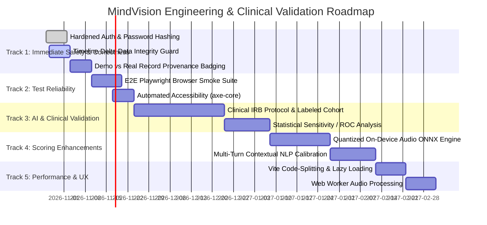

# MindVision Clinical AI — Prioritized Engineering & Validation Roadmap

**Document Version:** 1.0.0
**Effective Date:** October 26, 2026
**Auditor / Architect:** Senior Software Architect, QA Engineer, AI/ML Validation Engineer
**Companion Document:** [`docs/MINDVISION_AUDIT_REPORT.md`](file:///Users/kjaswanth/Desktop/performance%20delta/docs/MINDVISION_AUDIT_REPORT.md)

---

## Roadmap Overview

This improvement roadmap translates the findings from the MindVision comprehensive audit into a prioritized, actionable engineering plan. Work is organized into six structured tracks, strictly separating **essential corrections and safety safeguards** from **optional product enhancements**.

---

## Track 1: Immediate Correctness and Safety Fixes (Essential / P0–P1)

*Goal: Remediate security vulnerabilities, eliminate fabricated fallback data, and safeguard patient data integrity.*

### 1.1 Secure Clinician Authentication & Password Verification (P0)
* **Problem:** `DoctorController.login` currently issues Admin JWTs when `{ role: 'ADMIN' }` is passed without verifying any password. In the frontend, role switching is stored in unverified `localStorage`.
* **Action Items:**
  1. Add password hashing using `bcrypt` (or Node.js native `crypto.scrypt`).
  2. Implement a secure password verification check on `/api/doctors/login`.
  3. Store authentication tokens in secure, `HttpOnly`, `SameSite=Strict` cookies or transient memory rather than plaintext `localStorage`.
  4. Ensure backend route guards enforce role authorization on every sensitive clinician endpoint.

### 1.2 Eliminate Silent Fallback to Fabricated Metrics in Timeline Delta (P1)
* **Problem:** In [`telemetryTimelineService.js`](file:///Users/kjaswanth/Desktop/performance%20delta/backend/src/services/telemetryTimelineService.js#L291), empty metric payloads silently default to `compositeRisk: 6.3` and AU04 `0.55`, generating a report claiming patient distress escalated by +1.5.
* **Action Items:**
  1. Add strict schema validation to `calculateDelta()` and `compareSessions()`.
  2. If `currentMetrics` lacks valid telemetry, return a status of `INSUFFICIENT_TELEMETRY` instead of inventing baseline metrics.
  3. Add an `isSimulated: boolean` flag to distinguish runtime testing values from authentic recorded check-ins.

### 1.3 Data Provenance Badging for Pre-Seeded Records (P2)
* **Problem:** First-time users have 4 pre-populated demonstration check-ins from September 2026 in `localStorage.mindvision_patient_records`.
* **Action Items:**
  1. Add `isDemo: true` flag to `INITIAL_RECORDS`.
  2. Display a subtle "Sample Record" badge on demonstration records in `PatientHistoryView`.
  3. Provide a clear "Start Fresh / Clear Demo Data" button in settings.

---

## Track 2: Test Coverage and Reliability (Essential / P1)

*Goal: Expand automated verification beyond unit tests into cross-browser automation and accessibility compliance.*

### 2.1 Cross-Browser End-to-End (E2E) Test Suite (P1)
* **Current State:** 76 unit tests pass in Node native test runner (`node --test`), but end-to-end browser workflows (camera permissions, canvas rendering, SVG tooltip interactions) rely on manual testing.
* **Action Items:**
  1. Configure Playwright with Chromium fake media flags (`--use-fake-device-for-media-stream`, `--use-fake-ui-for-media-stream`).
  2. Automate full 4-question check-in workflow with mocked microphone input.
  3. Test PDF generation and file download verification in headless Chrome.

### 2.2 Automated Accessibility & Contrast Regression Tests (P2)
* **Current State:** Keyboard navigation and ARIA attributes exist across modals and charts, but automated WCAG compliance scanning is not integrated.
* **Action Items:**
  1. Add `@axe-core/playwright` to CI workflow.
  2. Verify that color contrast across light and dark themes strictly meets WCAG 2.1 AA (4.5:1 for body text, 3:1 for graphical UI components).
  3. Verify keyboard tab-order and focus restoration in all modals (`DoctorAuthModal`, `DoctorDirectoryModal`, `TeletherapySessionModal`).

---

## Track 3: AI Measurement and Clinical Ground-Truth Validation (Essential / P1)

*Goal: Establish legitimate empirical accuracy, sensitivity, and calibration against genuine clinical benchmarks.*

### 3.1 Establish an Empirical Labeled Evaluation Dataset (P1)
* **Current State:** No labeled real-world clinical dataset exists in the repository. Real-world accuracy has not been established.
* **Action Items:**
  1. Source or partner with an academic/clinical institution (e.g., NIMHANS or university clinical psychology department) to obtain an IRB-compliant multimodal dataset with paired clinician-administered scores (HAM-D, MADRS, PHQ-9).
  2. Alternatively, ingest an approved research benchmark subset (e.g., DAIC-WOZ audio transcripts and PHQ-8 scores).
  3. Establish a permanent evaluation split: 70% calibration, 15% validation, 15% held-out test.

### 3.2 Formal AI Validation Metrics Protocol (P1)
* **Protocol Requirements:**
  1. **Binary / Multiclass Classification:**
     - Measure Sensitivity (Recall), Specificity, Precision, Balanced Accuracy, and F1-Score for detecting Elevated / Severe risk states.
     - Plot Receiver Operating Characteristic (ROC) curves and calculate ROC-AUC with 95% bootstrap confidence intervals.
  2. **Continuous Severity Regression:**
     - Measure Mean Absolute Error (MAE) and Root Mean Squared Error (RMSE) against standardized scale totals.
     - Compute Bland-Altman agreement plots to assess systemic bias across severity ranges.
  3. **Demographic Invariance & Bias Audits:**
     - Measure equal opportunity metrics across gender, age brackets, and skin tone classifications (Fitzpatrick scale I–VI) to prevent disparate impact.

---

## Track 4: Model and Scoring Improvements (Medium Priority / P2)

*Goal: Transition from heuristic rule-based approximations to genuine edge machine learning inference.*

### 4.1 On-Device Acoustic Feature Extraction via Quantized ONNX (P2)
* **Current State:** Pitch tremor is approximated via 256-bin FFT peak magnitude from native Web Audio API.
* **Enhancement:**
  1. Integrate an on-device ONNX runtime (`onnxruntime-web`) executing a quantized acoustic model (e.g., a lightweight `wav2vec2` feature extractor or openSMILE eGeMAPS acoustic prosody extractor).
  2. Extract authentic acoustic features: F0 fundamental frequency variability, jitter (local pitch perturbation), shimmer (amplitude perturbation), and harmonics-to-noise ratio (HNR).

### 4.2 Multi-Turn Contextual Linguistic Embedding Engine (P2)
* **Current State:** Sentiment stress uses keyword lexicon matching with a 32-character negation window.
* **Enhancement:**
  1. Evaluate client-side WebAssembly embedding models (e.g., quantized `all-MiniLM-L6-v2` via Transformers.js).
  2. Evaluate semantic embeddings across the entire conversational dialogue to capture subtle emotional fatigue, cognitive distortions, and longitudinal sentiment progression across questions.

### 4.3 Calibration of Missing-Channel Weighting (P2)
* **Current State:** If text is blank or skipped, linguistic stress falls back to a default `0.15` (calm), which could artificially suppress risk for an uncommunicative or severely distressed patient.
* **Enhancement:**
  1. If verbal disclosure contains zero valid tokens, mark the linguistic channel as `UNAVAILABLE` rather than assigning a calm default score.
  2. If all channels are unavailable, output an `INCONCLUSIVE_DATA` assessment rather than calculating a `1.5/10 (MINIMAL)` score.

---

## Track 5: Performance, Usability & User Experience (Medium Priority / P2)

*Goal: Optimize bundle size, reduce client resource consumption, and refine user interface interactions.*

### 5.1 Dynamic Code-Splitting & Bundle Optimization (P2)
* **Current State:** Vite production build generates a 1,210 kB main JavaScript bundle (`index-BgZjW760.js`) containing React, jsPDF, html2canvas, and DOMPurify all in one synchronous chunk.
* **Enhancement:**
  1. Use `React.lazy()` and dynamic `import()` for heavy secondary views:
     - `DocumentationView.jsx`
     - `AdminVerificationView.jsx`
     - `ClinicianPortal.jsx`
     - `TeletherapySessionModal.jsx`
  2. Split `jspdf` and `html2canvas` into an asynchronous chunk loaded on-demand only when a patient clicks "Download PDF".
  3. Target main bundle size under 300 kB gzip.

### 5.2 Offload Video and Audio Processing to Web Workers (P2)
* **Current State:** Canvas frame drawing and MediaPipe landmark processing run on the main UI thread via `requestAnimationFrame`.
* **Enhancement:**
  1. Move offscreen canvas frame analysis to an `OffscreenCanvas` in a dedicated Web Worker.
  2. Prevent any UI frame drops or button lag during high-frequency face landmark tracking on lower-powered mobile devices.

---

## Track 6: Future Product Features (Optional Enhancements / P3)

*Goal: Long-term clinical and patient capabilities after core validation and security are established.*

1. **FHIR / SMART-on-FHIR Interoperability (P3):**
   - Export check-in summaries as standardized HL7 FHIR `Observation` and `DiagnosticReport` JSON resources for integration with hospital Electronic Health Record (EHR) systems (Epic, Cerner).
2. **End-to-End Encrypted Multi-Party WebRTC (P3):**
   - Replace simulated video call HUD with authentic WebRTC P2P signaling backed by coturn (STUN/TURN) and end-to-end encrypted video streams.
3. **Longitudinal Medication & Symptom Tracker (P3):**
   - Allow patients to log medication adherence alongside daily check-ins to correlate psychophysiological telemetry with pharmacotherapy adjustments.
4. **Offline PWA Support (P3):**
   - Configure service worker caching for offline wellness tools (Guided Breathing, Private Journal, Mood Tracker).
